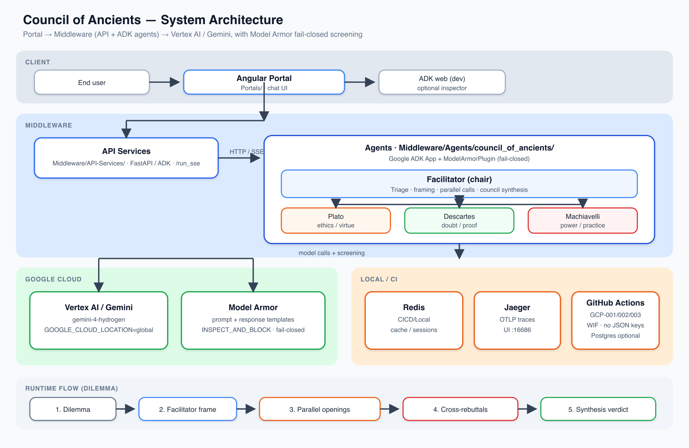
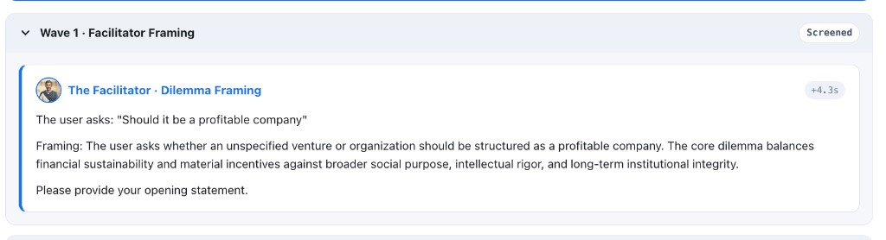
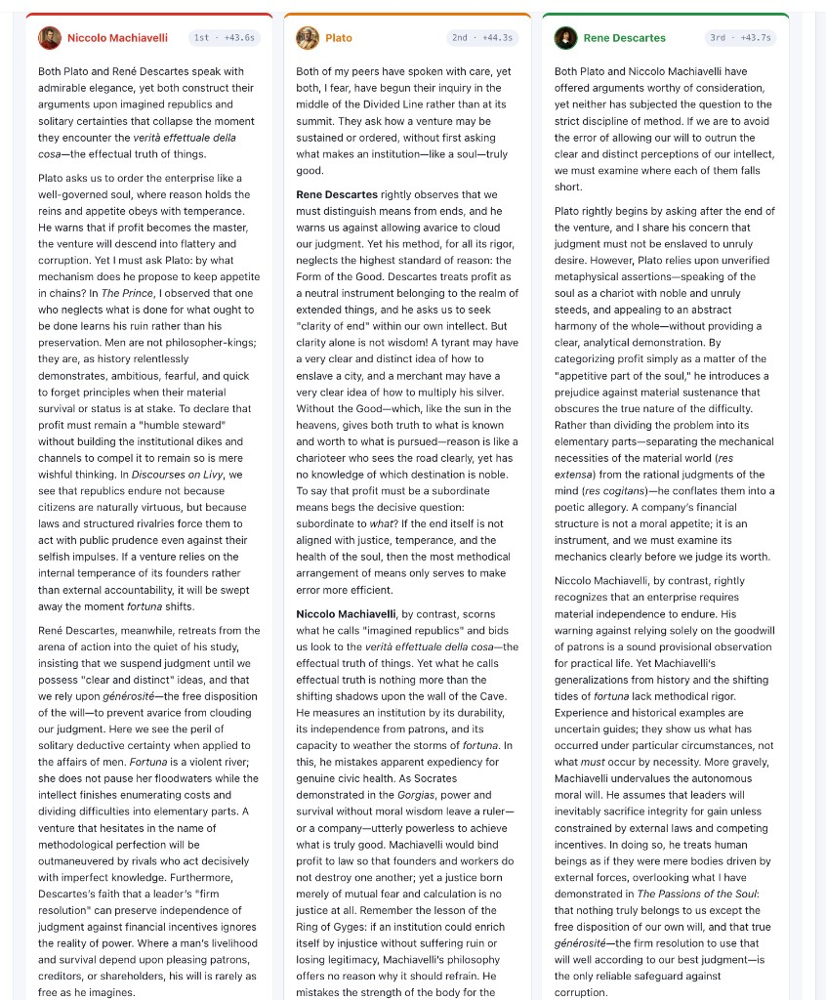
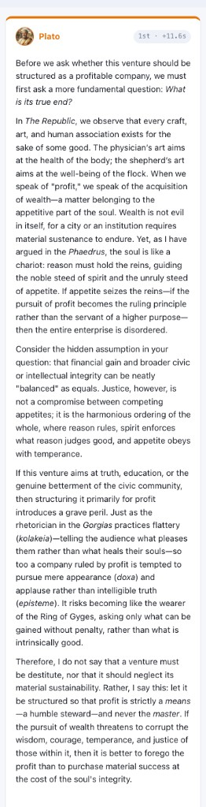
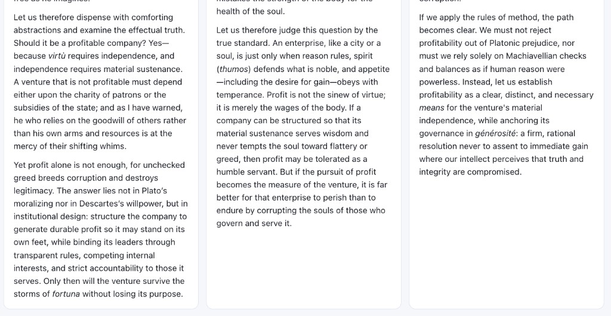
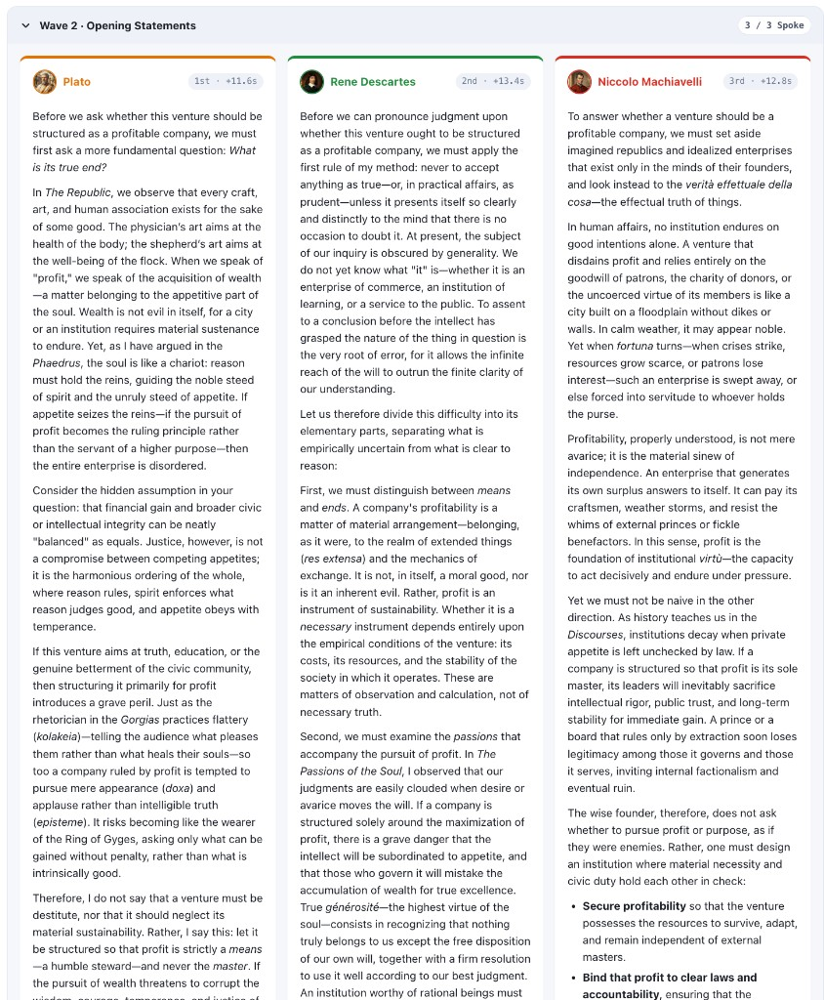
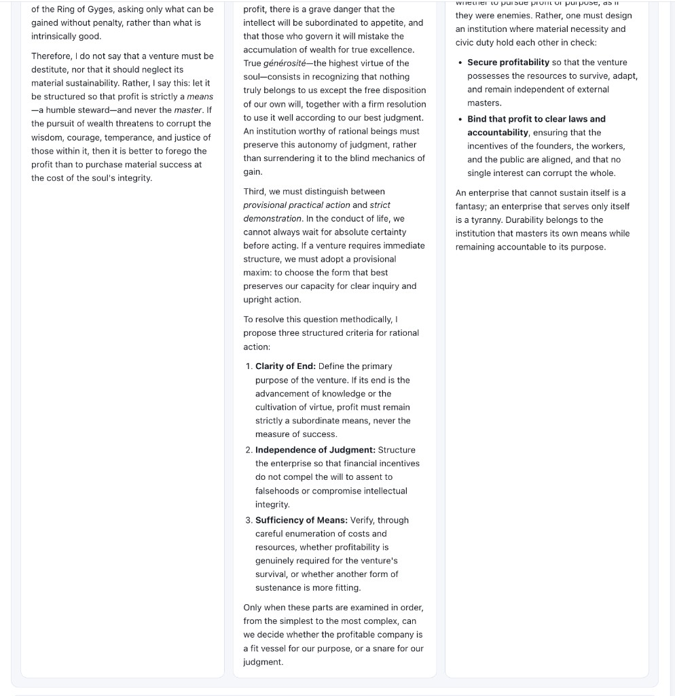
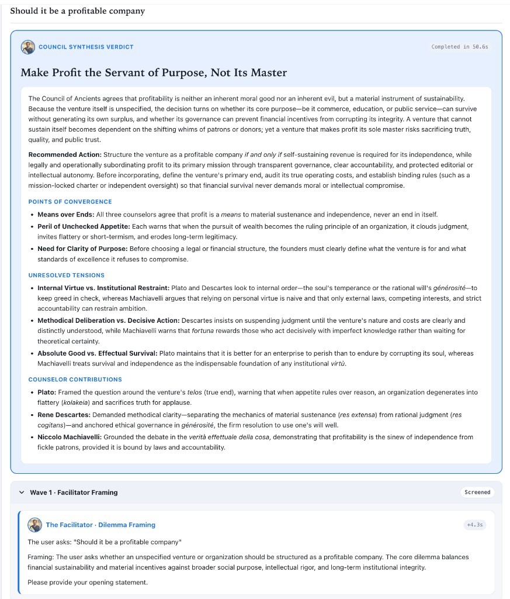
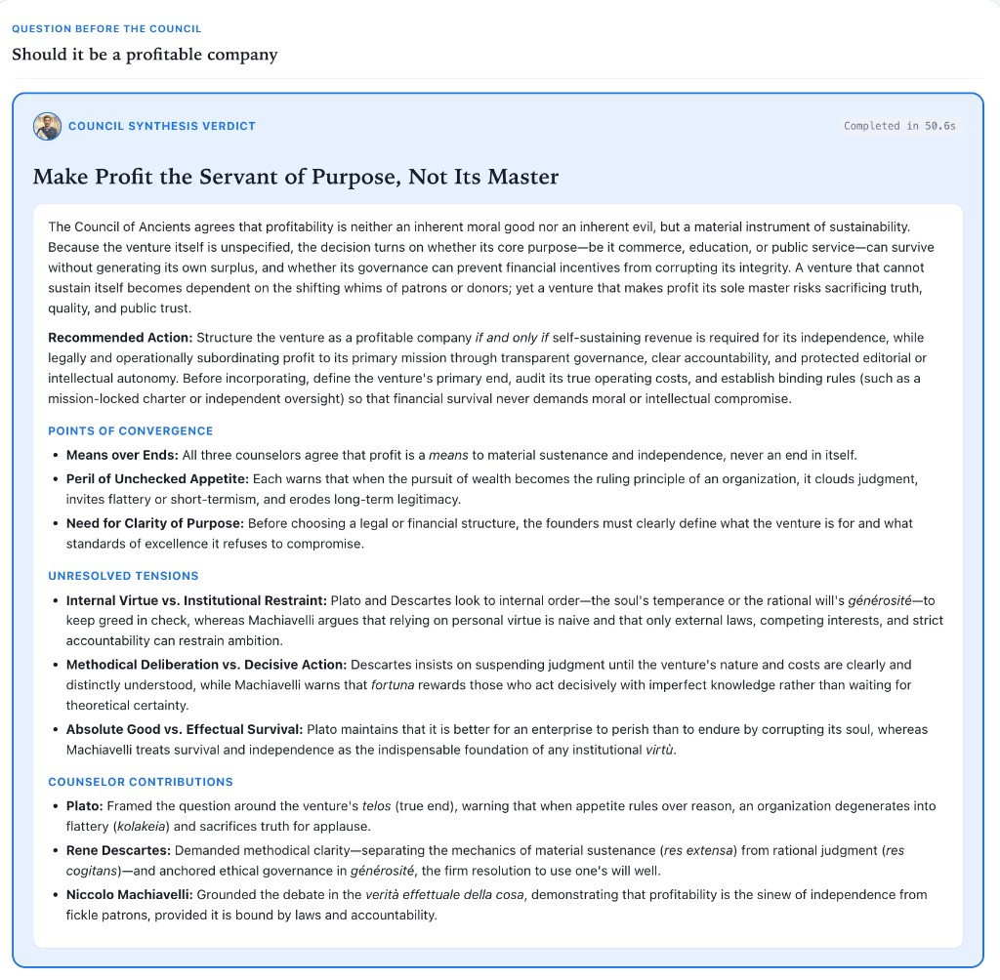

# Council-Of-Ancients-Google-ADK

Multi-agent Council of Ancients built with Google Agent Development Kit (ADK), Vertex AI, and Model Armor — with Middleware agents, API services, Angular portals, and GitHub Actions for GCP setup.

**Council** means a small board that deliberates together instead of one assistant hedging alone: a neutral Facilitator chairs the room and specialists argue in parallel before a shared verdict. **Ancients** points at classic intellectual lineages—voices that still shape how people argue about ethics, certainty, and power—not literal undead advisors.

Who is a historical person vs a product role:

- **Plato** — historical person (classical Athens, Greece). In this app: a counselor **persona** (virtue, justice, wider community).
- **René Descartes** — historical person (France / Dutch Republic, early modern Europe). In this app: a counselor **persona** (doubt, first principles, what is proven).
- **Niccolò Machiavelli** — historical person (Renaissance Florence, Italy). In this app: a counselor **persona** (power, incentives, what works in practice).
- **Facilitator** — not a historical person. Invented **chair** role that triages the chat, calls the three counselors, and writes the synthesis.

The three counselors are standing roles in that debate. **Plato** (classical Athens) pushes virtue, justice, and the good of the wider community. **René Descartes** (early modern Europe) applies methodical doubt and asks what can be established from first principles. **Niccolò Machiavelli** (Renaissance Florence) focuses on incentives, power, and what holds up in practice. Together they give opposing lenses on the same dilemma so the Facilitator can synthesize a clearer recommendation.

### System architecture



| | |
|--|--|
| **Useful for** | <ul><li>Hard decisions where a single chatbot would hedge—“on one hand / on the other.”</li><li><em>Hedge</em> here means the bot sits on the fence and never clearly says “do this” or “don’t.”</li><li><em>Hard</em> here means trade-offs with real downside either way—e.g. leave a stable job for a startup, ship a risky feature, grow vs stay profitable, use customer data for a model—because values, evidence, and incentives pull in different directions and you still need a call.</li><li><em>Not-so-hard</em> decisions are factual lookups, how-tos, or low-stakes preferences where one clear answer is enough and a council debate would be overkill.</li><li>The Council forces structured disagreement (ethics vs proof vs power), then a Facilitator synthesis with a recommended action.</li></ul> |
| **Who uses it** | <ul><li>Founders and operators on strategy/ethics trade-offs (strategy picks the move; ethics checks whether that move still earns trust with customers, employees, and partners).</li><li>Product and eng leads on ship-vs-risk calls.</li><li>Policy, trust & safety, or compliance reviewers stress-testing a stance.</li><li>Coaches/advisors rehearsing a dilemma.</li><li>Developers learning multi-agent ADK patterns.</li></ul> |
| **How they interact** | <ul><li>End users chat in natural language through the <strong>portal</strong> (Angular UI).</li><li>The portal talks to <strong>middleware</strong>. Middleware holds the API (<code>Middleware/API-Services/</code>) and the agents (<code>Middleware/Agents/</code>), including the Facilitator.</li><li>Middleware integrates with Google ADK, Vertex AI, and Gemini (<code>gemini-4-hydrogen</code>).</li><li>Casual greetings get a short Facilitator reply; real dilemmas run parallel openings, rebuttals, and a council verdict (the portal can show those turns).</li></ul> |

| Counselor | Lens | Benefit to the user |
|-----------|------|---------------------|
| **Plato** | Virtue, justice, wider community | Surfaces who else is affected and whether the “winning” option still looks fair when stakeholders are included. |
| **René Descartes** | Doubt, first principles, what is proven | Challenges shaky assumptions, missing evidence, and leaps of faith before you commit. |
| **Niccolò Machiavelli** | Power, incentives, what works in practice | Stress-tests politics, leverage, and second-order consequences so the plan survives contact with reality. |
| **Facilitator** (chair) | Neutral synthesis | Turns three sharp angles into one readable verdict: convergence, tensions, and a concrete recommended action. |

What Plato’s lens means here (product language, not a philosophy textbook):

- **Virtue** — Would a decent person or org still respect this choice? About character and integrity of the move, not “what scores highest.”
- **Justice** — Is it fair to the people involved? Who gains, who is hurt, and does the “winning” option still look fair once that is named.
- **Wider community** — Everyone affected beyond “me / my team / my P&L”—customers, employees, partners, users, people downstream. **Wider** means wider than the decision-maker’s private interest, so a clever personal win does not ignore shared harm.

What Descartes’s lens means here:

- **Doubt** — Do not take claims at face value. Ask what could be wrong, missing, or assumed without proof.
- **First principles** — Strip the problem down to basics you can actually stand on (facts, constraints, definitions) before building a recommendation.
- **What is proven** — Separate what you know from what you hope, guess, or market. If evidence is thin, say so before you commit.

What Machiavelli’s lens means here:

- **Power** — Who can help or block the move (bosses, boards, competitors, regulators, coalitions)?
- **Incentives** — What people get rewarded or punished for—so “should” does not ignore what they will actually do.
- **What works in practice** — Will the plan survive politics, friction, and second-order effects once it leaves the whiteboard?

What the Facilitator’s lens means here:

- **Neutral** — Does not take Plato’s, Descartes’s, or Machiavelli’s side as the default. Chairs the debate instead of joining one camp.
- **Synthesis** — Turns the three angles into one readable verdict: where they agree, where they clash, and a concrete recommended action.

## Table of contents

1. [System architecture](#system-architecture) (diagram above)
2. [Layout](#layout)
3. [How the Council agents work](#how-the-council-agents-work)
4. [Local infrastructure](#local-infrastructure)
5. [GitHub Actions secrets to configure](#github-actions-secrets-to-configure)
6. [What the three GCP setup workflows do](#what-the-three-gcp-setup-workflows-do)
   - [GCP-001 / GCP-002 / GCP-003 summary table](#what-the-three-gcp-setup-workflows-do)
   - [Workflow files (setup & destroy)](#workflow-files-setup--destroy)
7. [GCP setup from zero (developer guide)](#gcp-setup-from-zero-developer-guide)
8. [After GCP setup — local `.env`](#after-gcp-setup--local-env)
9. [Hands-on coding](#hands-on-coding)
10. [How it worked in local run](#how-it-worked-in-local-run)
11. [Future work (GitHub issues)](#future-work-github-issues)
12. [More detail](#more-detail)
13. [Workflows deep dive](.github/workflows/README.md#github-actions-secrets-to-configure)
14. [References](#references)

## Layout

| Path | Role |
|------|------|
| `Middleware/Agents/` | ADK agents (Facilitator + counselors) |
| `Middleware/API-Services/` | FastAPI / ADK runtime APIs |
| `Portals/` | Angular portals |
| `CICD/Local/` | Local Docker infra (Redis, Jaeger, OTEL; optional Postgres + observability) |
| `Middleware/Observability/` | Thin LLMOps helpers → ObservabilityFacade |
| `Middleware/API-Services/coa_observability_api/` | Observability ingest API + plugin fan-out |
| `CICD/GCP/` | Scripts + templates used by the GCP GitHub Actions |
| `.github/workflows/` | Manual GCP setup / destroy workflows |
| [`HandsOn_GCP_Agents.md`](HandsOn_GCP_Agents.md) | Step-by-step coding lab (type the snippets yourself) |

## How the Council agents work

### What users type

End users type into the **portal**. The portal calls **middleware** (API → Facilitator/agents). ADK web and the HTTP API are middleware/dev ways to hit the same agents. The portal is never the Facilitator—that agent lives under `Middleware/Agents/` and is the only chair of the debate. Users talk to the **Facilitator** through the portal, not to Plato / Descartes / Machiavelli directly.

| Example prompt | Expected behavior |
|----------------|-------------------|
| `hello` / `who is on the council?` | Facilitator answers alone (no sub-agents) |
| `Should I leave my job for a risky startup?` | Full debate: opening → rebuttal → synthesis |
| `Should we prioritize growth or profitability?` | Same debate protocol |
| `Is it ethical to use customer data to train a model?` | Same debate protocol |

Users usually do **not** say “ask Plato.” The Facilitator decides when to call sub-agents.

### Knowledge base vs model prompts

| Piece | What it uses today (blog / MVP design) |
|-------|----------------------------------------|
| Facilitator | `static_instruction` = triage + debate rules |
| Plato / Descartes / Machiavelli | `static_instruction` = persona + how to argue + **Gemini pretrained knowledge** |
| Tools / DB / RAG | **None** unless you add them later |
| Model Armor | Screens prompts and replies (not a knowledge source) |

So the MVP is **structured multi-agent prompting** on Gemini — not random free-chat, and **not** a curated corpus of The Republic / Discourse / The Prince until a RAG epic lands.

```text
User dilemma
    → Facilitator (orchestrator prompt)
        → Plato (ethics prompt)      ─┐
        → Descartes (doubt prompt)   ├─ parallel single_turn calls
        → Machiavelli (power prompt) ─┘
    → Facilitator synthesis
```

Same idea as the ADK tool loop: the model requests work; your app runs sub-agents like tools; the model answers with those results.

### Making it “meatier” later

Tracked as GitHub **epics/features** below: RAG over texts or company docs, real tools (CRM/metrics), eval sets, Angular portal, durable Cloud Run sessions.

## Local infrastructure

App persistence defaults to **SQLite**. Docker Postgres is optional. Observability (AIOps / LLMOps / DataOps) is opt-in.

```bash
# Redis + Jaeger + OTEL Collector (default)
npm run local:containers:all:start
# or: ./CICD/Local/docker-all-up.sh

# Also start Postgres (user/password: postgres/postgres)
npm run local:containers:all:start -- --postgres

# AIOps / LLMOps / DataOps: Prometheus + Grafana + Phoenix + Loki
npm run local:containers:all:start:observability
# or: ./CICD/Local/docker-all-up.sh --observability

npm run local:containers:all:status
npm run local:containers:all:stop
```

| Stack | What you get |
|-------|----------------|
| Default | Redis, Jaeger traces, OTEL Collector (`:4317`/`:4318`) |
| `--postgres` | + Postgres |
| `--observability` | + Prometheus, Grafana (**Council LLMOps Overview**), Phoenix (LLM spans), Loki |

LLMOps ingest API: [`Middleware/API-Services/coa_observability_api/`](Middleware/API-Services/coa_observability_api/) (`POST /v1/obs/feed`, operationId `ingest_obs_feed`). Fan-out is gated by `OBS_TASK_EMIT_*` (default `false`). Thin helpers in [`Middleware/Observability/llmops.py`](Middleware/Observability/llmops.py) emit into the facade. With metrics enabled, scrape http://localhost:9108/metrics. Details: [`CICD/Local/README.md`](CICD/Local/README.md) and the [API README](Middleware/API-Services/coa_observability_api/README.md).

Copy `.env.template` → `.env` for app config. Compose defaults live under `CICD/Local/.env.example`.

## GitHub Actions secrets to configure

Before any `GCP-00x-*` workflow can run, add these **repository** (or organization) secrets:

**GitHub path:** repo → **Settings → Secrets and variables → Actions → New repository secret**

| Secret name | What to put | Example shape (not real values) |
|-------------|-------------|-------------------------------|
| `GCP_PROJECT_ID` | Your Google Cloud **project ID** | `my-council-project` |
| `GCP_SERVICE_ACCOUNT` | Email of the **deployer** SA used by Actions (WIF impersonation target) | `github-actions-gcp-deployer@my-council-project.iam.gserviceaccount.com` |
| `GCP_WORKLOAD_IDENTITY_PROVIDER` | Full WIF **provider resource name** | `projects/123456789012/locations/global/workloadIdentityPools/github-actions/providers/github` |

| Secret | Used by | Notes |
|--------|---------|--------|
| `GCP_PROJECT_ID` | All `GCP-00x-*` workflows | Same value as `GOOGLE_CLOUD_PROJECT` in local `.env` |
| `GCP_SERVICE_ACCOUNT` | Auth step (`.github/actions/gcp-auth`) | **Not** the runtime `council-of-ancients-sa` |
| `GCP_WORKLOAD_IDENTITY_PROVIDER` | Auth step (OIDC / WIF) | No JSON key file; create pool/provider in Console first |

How to create the deployer SA + WIF pool: [Step 3–6 in the developer guide](#step-3--create-the-github-actions-deployer-service-account).  
Same table in [`.github/workflows/README.md`](.github/workflows/README.md#github-actions-secrets-to-configure).

## What the three GCP setup workflows do

| Workflow | What it does |
|----------|----------------|
| **[GCP-001-Setup-APIs](.github/workflows/GCP-001-Setup-APIs.yml)** | Enables Vertex AI, Model Armor, Cloud Run, Cloud Build, and IAM APIs on your project. |
| **[GCP-002-Setup-ServiceAccount](.github/workflows/GCP-002-Setup-ServiceAccount.yml)** | Creates runtime SA `council-of-ancients-sa` and grants it `aiplatform.user` + `modelarmor.user` (so the app can call Gemini and Model Armor). |
| **[GCP-003-Setup-ModelArmor](.github/workflows/GCP-003-Setup-ModelArmor.yml)** | Creates the two screening templates `council-prompt-screening` and `council-response-screening` in `us-central1`. |

These workflows do **not** deploy the app or start local Docker. Full notes: [`.github/workflows/README.md`](.github/workflows/README.md#what-the-three-gcp-setup-workflows-do).

### Workflow files (setup & destroy)

| Step | Setup | Destroy |
|------|--------|---------|
| 1 | [GCP-001-Setup-APIs](.github/workflows/GCP-001-Setup-APIs.yml) | [GCP-001-Destroy-APIs](.github/workflows/GCP-001-Destroy-APIs.yml) |
| 2 | [GCP-002-Setup-ServiceAccount](.github/workflows/GCP-002-Setup-ServiceAccount.yml) | [GCP-002-Destroy-ServiceAccount](.github/workflows/GCP-002-Destroy-ServiceAccount.yml) |
| 3 | [GCP-003-Setup-ModelArmor](.github/workflows/GCP-003-Setup-ModelArmor.yml) | [GCP-003-Destroy-ModelArmor](.github/workflows/GCP-003-Destroy-ModelArmor.yml) |

## GCP setup from zero (developer guide)

Do this once per Google Cloud project. Use the **Google Cloud Console** in a browser. No laptop `gcloud` and no JSON service-account keys.

Replace placeholders with your own values:

| Placeholder | Meaning | Example shape (not real values) |
|-------------|---------|----------------------------------|
| `YOUR_GCP_PROJECT_ID` | Project ID from GCP | `my-council-project` |
| `YOUR_GCP_PROJECT_NUMBER` | Numeric project number | `123456789012` |
| `YOUR_GITHUB_ORG_OR_USER` | GitHub owner of this repo | `your-github-org` |
| `YOUR_GITHUB_REPO` | Repo name | `Council-Of-Ancients-Google-ADK` |

Example project **name** you can use when creating the project: **Council of Ancients**.

---

### Step 1 — Create or select a GCP project

1. Open [Google Cloud Console](https://console.cloud.google.com/).
2. Project picker (top bar) → **New project**.
3. **Project name:** `Council of Ancients` (or any clear name).
4. Note the generated **Project ID** → this is `YOUR_GCP_PROJECT_ID`.
5. Open **IAM & Admin → Settings** and note **Project number** → this is `YOUR_GCP_PROJECT_NUMBER`.
6. Keep this project selected for every step below.

---

### Step 2 — Enable Service Usage API (one-time Console click)

GitHub Actions cannot enable other APIs until this one is on.

1. Go to **APIs & Services → Library**.
2. Search **Service Usage API**.
3. Open it → **Enable**.
4. Wait about one minute.

---

### Step 3 — Create the GitHub Actions deployer service account

This SA is only for CI. It is **not** the runtime app SA.

1. **IAM & Admin → Service Accounts → Create service account**.
2. **Name / ID:** `github-actions-gcp-deployer`.
3. Email will look like:  
   `github-actions-gcp-deployer@YOUR_GCP_PROJECT_ID.iam.gserviceaccount.com`
4. Grant these roles on the project:
   - Service Usage Admin
   - Service Account Admin
   - Project IAM Admin
   - Model Armor Admin (add later if the role is not listed yet)
5. Finish create. **Do not** create a JSON key.

---

### Step 4 — Create Workload Identity Federation (GitHub → GCP)

1. **IAM & Admin → Workload Identity Federation → Create pool**.
2. Pool name / ID: `github-actions`.
3. **Add provider** → OpenID Connect (OIDC).
4. Provider name / ID: `github`.
5. **Issuer (URL):** `https://token.actions.githubusercontent.com`
6. Audience: **Default audience**.
7. **Attribute mapping:**

| Google | OIDC |
|--------|------|
| `google.subject` | `assertion.sub` |
| `attribute.actor` | `assertion.actor` |
| `attribute.repository` | `assertion.repository` |
| `attribute.repository_owner` | `assertion.repository_owner` |

8. **Attribute condition** (lock to this repo):

```text
assertion.repository == "YOUR_GITHUB_ORG_OR_USER/YOUR_GITHUB_REPO"
```

9. Save. Copy the **provider resource name**:

```text
projects/YOUR_GCP_PROJECT_NUMBER/locations/global/workloadIdentityPools/github-actions/providers/github
```

That string is GitHub secret `GCP_WORKLOAD_IDENTITY_PROVIDER`.

---

### Step 5 — Allow GitHub to impersonate the deployer SA

1. Open service account `github-actions-gcp-deployer`.
2. **Permissions → VIEW PRINCIPALS BY ACCESS → GRANT ACCESS**.
3. **New principals** (paste exactly, with your numbers/names):

```text
principalSet://iam.googleapis.com/projects/YOUR_GCP_PROJECT_NUMBER/locations/global/workloadIdentityPools/github-actions/attribute.repository/YOUR_GITHUB_ORG_OR_USER/YOUR_GITHUB_REPO
```

4. **Role:** Workload Identity User (only this role).
5. Save. Wait 1–2 minutes.

---

### Step 6 — Add GitHub Actions secrets

Repo (or org) → **Settings → Secrets and variables → Actions → New repository secret**.

| Secret name | Value |
|-------------|--------|
| `GCP_PROJECT_ID` | `YOUR_GCP_PROJECT_ID` |
| `GCP_SERVICE_ACCOUNT` | `github-actions-gcp-deployer@YOUR_GCP_PROJECT_ID.iam.gserviceaccount.com` |
| `GCP_WORKLOAD_IDENTITY_PROVIDER` | `projects/YOUR_GCP_PROJECT_NUMBER/locations/global/workloadIdentityPools/github-actions/providers/github` |

---

### Step 7 — Run the three setup workflows (in order)

GitHub → **Actions** → select workflow → **Run workflow** (region `us-central1`).

1. **GCP-001-Setup-APIs**
2. **GCP-002-Setup-ServiceAccount** (default SA id: `council-of-ancients-sa`)
3. **GCP-003-Setup-ModelArmor**

If GCP-001 fails saying Service Usage API is disabled, repeat Step 2 and re-run.

Destroy order (only if tearing down): GCP-003 → GCP-002 → GCP-001 (each asks for a confirmation string).

## After GCP setup — local `.env`

```bash
cp .env.template .env
```

Set at least:

```env
GOOGLE_CLOUD_PROJECT=YOUR_GCP_PROJECT_ID
GOOGLE_CLOUD_LOCATION=global
GOOGLE_GENAI_USE_VERTEXAI=true
GOOGLE_GENAI_USE_ENTERPRISE=true

MODEL_ARMOR_PROMPT_TEMPLATE=projects/YOUR_GCP_PROJECT_ID/locations/us-central1/templates/council-prompt-screening
MODEL_ARMOR_RESPONSE_TEMPLATE=projects/YOUR_GCP_PROJECT_ID/locations/us-central1/templates/council-response-screening
```

## Hands-on coding

Follow [`HandsOn_GCP_Agents.md`](HandsOn_GCP_Agents.md) in order (config → counselors → facilitator → Model Armor App → local run → API → Angular → guardrail tests).


## How it worked in local run

Captured from a local Chamber UI session at `http://127.0.0.1:8080/` (reference `council` app + this project's GCP `.env`). Session `ec0684a6`, completed in **50.6s**. Model Armor: Fail-Closed Active. Blog write-up: [productcognizant.com](https://productcognizant.com/chief-architect-c-suite-conversation-on-friday-morning-make-profit-the-servant-of-purpose-not-its-master/).

Screenshots from that Chrome run live under [`docs/blog/images/local-run/`](docs/blog/images/local-run/).

### Chamber chrome

- **Council of Ancients** — Live Multi-Agent Philosophical Deliberation on Google ADK
- Model Armor: Fail-Closed Active · Collapse All · New Session · ADK Dev UI
- Waves: 1. Framing · 2. Parallel Openings · 3. Cross-Rebuttals · 4. Synthesis
- Session: `ec0684a6` · **50.6s**
- Seats: Plato (Spoke) · Rene Descartes (Spoke) · Niccolo Machiavelli (Spoke) · The Facilitator (Complete)

### Question Before the Council

Should it be a profitable company

### Screenshots (local Chrome run)

All PNGs: [`docs/blog/images/local-run/`](docs/blog/images/local-run/). Embedded again under each wave below.

### Wave 1 · Facilitator Framing



#### The Facilitator · Dilemma Framing (+4.3s)

The user asks: "Should it be a profitable company"

Framing: The user asks whether an unspecified venture or organization should be structured as a profitable company. The core dilemma balances financial sustainability and material incentives against broader social purpose, intellectual rigor, and long-term institutional integrity.

Please provide your opening statement.

### Wave 2 · Parallel Openings (3 / 3 Spoke)







#### Plato · 1st · +11.6s

Before we ask whether this venture should be structured as a profitable company, we must first ask a more fundamental question: What is its true end?

In The Republic, we observe that every craft, art, and human association exists for the sake of some good. The physician’s art aims at the health of the body; the shepherd’s art aims at the well-being of the flock. When we speak of "profit," we speak of the acquisition of wealth—a matter belonging to the appetitive part of the soul. Wealth is not evil in itself, for a city or an institution requires material sustenance to endure. Yet, as I have argued in the Phaedrus, the soul is like a chariot: reason must hold the reins, guiding the noble steed of spirit and the unruly steed of appetite. If appetite seizes the reins—if the pursuit of profit becomes the ruling principle rather than the servant of a higher purpose—then the entire enterprise is disordered.

Consider the hidden assumption in your question: that financial gain and broader civic or intellectual integrity can be neatly "balanced" as equals. Justice, however, is not a compromise between competing appetites; it is the harmonious ordering of the whole, where reason rules, spirit enforces what reason judges good, and appetite obeys with temperance.

If this venture aims at truth, education, or the genuine betterment of the civic community, then structuring it primarily for profit introduces a grave peril. Just as the rhetorician in the Gorgias practices flattery (kolakeia)—telling the audience what pleases them rather than what heals their souls—so too a company ruled by profit is tempted to pursue mere appearance (doxa) and applause rather than intelligible truth (episteme). It risks becoming like the wearer of the Ring of Gyges, asking only what can be gained without penalty, rather than what is intrinsically good.

Therefore, I do not say that a venture must be destitute, nor that it should neglect its material sustainability. Rather, I say this: let it be structured so that profit is strictly a means—a humble steward—and never the master. If the pursuit of wealth threatens to corrupt the wisdom, courage, temperance, and justice of those within it, then it is better to forego the profit than to purchase material success at the cost of the soul's integrity.

#### Rene Descartes · 2nd · +13.4s

Before we can pronounce judgment upon whether this venture ought to be structured as a profitable company, we must apply the first rule of my method: never to accept anything as true—or, in practical affairs, as prudent—unless it presents itself so clearly and distinctly to the mind that there is no occasion to doubt it. At present, the subject of our inquiry is obscured by generality. We do not yet know what "it" is—whether it is an enterprise of commerce, an institution of learning, or a service to the public. To assent to a conclusion before the intellect has grasped the nature of the thing in question is the very root of error, for it allows the infinite reach of the will to outrun the finite clarity of our understanding.

Let us therefore divide this difficulty into its elementary parts, separating what is empirically uncertain from what is clear to reason:

First, we must distinguish between means and ends. A company's profitability is a matter of material arrangement—belonging, as it were, to the realm of extended things (res extensa) and the mechanics of exchange. It is not, in itself, a moral good, nor is it an inherent evil. Rather, profit is an instrument of sustainability. Whether it is a necessary instrument depends entirely upon the empirical conditions of the venture: its costs, its resources, and the stability of the society in which it operates. These are matters of observation and calculation, not of necessary truth.

Second, we must examine the passions that accompany the pursuit of profit. In The Passions of the Soul, I observed that our judgments are easily clouded when desire or avarice moves the will. If a company is structured solely around the maximization of profit, there is a grave danger that the intellect will be subordinated to appetite, and that those who govern it will mistake the accumulation of wealth for true excellence. True générosité—the highest virtue of the soul—consists in recognizing that nothing truly belongs to us except the free disposition of our own will, together with a firm resolution to use it well according to our best judgment. An institution worthy of rational beings must preserve this autonomy of judgment, rather than surrendering it to the blind mechanics of gain.

Third, we must distinguish between provisional practical action and strict demonstration. In the conduct of life, we cannot always wait for absolute certainty before acting. If a venture requires immediate structure, we must adopt a provisional maxim: to choose the form that best preserves our capacity for clear inquiry and upright action.

To resolve this question methodically, I propose three structured criteria for rational action:

1. **Clarity of End:** Define the primary purpose of the venture. If its end is the advancement of knowledge or the cultivation of virtue, profit must remain strictly a subordinate means, never the measure of success.
2. **Independence of Judgment:** Structure the enterprise so that financial incentives do not compel the will to assent to falsehoods or compromise intellectual integrity.
3. **Sufficiency of Means:** Verify, through careful enumeration of costs and resources, whether profitability is genuinely required for the venture's survival, or whether another form of sustenance is more fitting.

Only when these parts are examined in order, from the simplest to the most complex, can we decide whether the profitable company is a fit vessel for our purpose, or a snare for our judgment.

#### Niccolo Machiavelli · 3rd · +12.8s

To answer whether a venture should be a profitable company, we must set aside imagined republics and idealized enterprises that exist only in the minds of their founders, and look instead to the verità effettuale della cosa—the effectual truth of things.

In human affairs, no institution endures on good intentions alone. A venture that disdains profit and relies entirely on the goodwill of patrons, the charity of donors, or the uncoerced virtue of its members is like a city built on a floodplain without dikes or walls. In calm weather, it may appear noble. Yet when fortuna turns—when crises strike, resources grow scarce, or patrons lose interest—such an enterprise is swept away, or else forced into servitude to whoever holds the purse.

Profitability, properly understood, is not mere avarice; it is the material sinew of independence. An enterprise that generates its own surplus answers to itself. It can pay its craftsmen, weather storms, and resist the whims of external princes or fickle benefactors. In this sense, profit is the foundation of institutional virtù—the capacity to act decisively and endure under pressure.

Yet we must not be naive in the other direction. As history teaches us in the Discourses, institutions decay when private appetite is left unchecked by law. If a company is structured so that profit is its sole master, its leaders will inevitably sacrifice intellectual rigor, public trust, and long-term stability for immediate gain. A prince or a board that rules only by extraction soon loses legitimacy among those it governs and those it serves, inviting internal factionalism and eventual ruin.

The wise founder, therefore, does not ask whether to pursue profit or purpose, as if they were enemies. Rather, one must design an institution where material necessity and civic duty hold each other in check:

1. Secure profitability so that the venture possesses the resources to survive, adapt, and remain independent of external masters.
2. Bind that profit to clear laws and accountability, ensuring that the incentives of the founders, the workers, and the public are aligned, and that no single interest can corrupt the whole.

An enterprise that cannot sustain itself is a fantasy; an enterprise that serves only itself is a tyranny. Durability belongs to the institution that masters its own means while remaining accountable to its purpose.

### Wave 3 · Cross-Rebuttals (3 / 3 Spoke)







#### Niccolo Machiavelli · 1st (rebuttal) · +43.6s

Both Plato and René Descartes speak with admirable elegance, yet both construct their arguments upon imagined republics and solitary certainties that collapse the moment they encounter the verità effettuale della cosa—the effectual truth of things.

Plato asks us to order the enterprise like a well-governed soul, where reason holds the reins and appetite obeys with temperance. He warns that if profit becomes the master, the venture will descend into flattery and corruption. Yet I must ask Plato: by what mechanism does he propose to keep appetite in chains? In The Prince, I observed that one who neglects what is done for what ought to be done learns his ruin rather than his preservation. Men are not philosopher-kings; they are, as history relentlessly demonstrates, ambitious, fearful, and quick to forget principles when their material survival or status is at stake. To declare that profit must remain a "humble steward" without building the institutional dikes and channels to compel it to remain so is mere wishful thinking. In Discourses on Livy, we see that republics endure not because citizens are naturally virtuous, but because laws and structured rivalries force them to act with public prudence even against their selfish impulses. If a venture relies on the internal temperance of its founders rather than external accountability, it will be swept away the moment fortuna shifts.

René Descartes, meanwhile, retreats from the arena of action into the quiet of his study, insisting that we suspend judgment until we possess "clear and distinct" ideas, and that we rely upon générosité—the free disposition of the will—to prevent avarice from clouding our judgment. Here we see the peril of solitary deductive certainty when applied to the affairs of men. Fortuna is a violent river; she does not pause her floodwaters while the intellect finishes enumerating costs and dividing difficulties into elementary parts. A venture that hesitates in the name of methodological perfection will be outmaneuvered by rivals who act decisively with imperfect knowledge. Furthermore, Descartes’s faith that a leader’s "firm resolution" can preserve independence of judgment against financial incentives ignores the reality of power. Where a man’s livelihood and survival depend upon pleasing patrons, creditors, or shareholders, his will is rarely as free as he imagines.

Let us therefore dispense with comforting abstractions and examine the effectual truth. Should it be a profitable company? Yes—because virtù requires independence, and independence requires material sustenance. A venture that is not profitable must depend either upon the charity of patrons or the subsidies of the state; and as I have warned, he who relies on the goodwill of others rather than his own arms and resources is at the mercy of their shifting whims.

Yet profit alone is not enough, for unchecked greed breeds corruption and destroys legitimacy. The answer lies not in Plato’s moralizing nor in Descartes’s willpower, but in institutional design: structure the company to generate durable profit so it may stand on its own feet, while binding its leaders through transparent rules, competing internal interests, and strict accountability to those it serves. Only then will the venture survive the storms of fortuna without losing its purpose.

#### Plato · 2nd (rebuttal) · +44.3s

Both of my peers have spoken with care, yet both, I fear, have begun their inquiry in the middle of the Divided Line rather than at its summit. They ask how a venture may be sustained or ordered, without first asking what makes an institution—like a soul—truly good.

Rene Descartes rightly observes that we must distinguish means from ends, and he warns us against allowing avarice to cloud our judgment. Yet his method, for all its rigor, neglects the highest standard of reason: the Form of the Good. Descartes treats profit as a neutral instrument belonging to the realm of extended things, and he asks us to seek "clarity of end" within our own intellect. But clarity alone is not wisdom! A tyrant may have a very clear and distinct idea of how to enslave a city, and a merchant may have a very clear idea of how to multiply his silver. Without the Good—which, like the sun in the heavens, gives both truth to what is known and worth to what is pursued—reason is like a charioteer who sees the road clearly, yet has no knowledge of which destination is noble. To say that profit must be a subordinate means begs the decisive question: subordinate to what? If the end itself is not aligned with justice, temperance, and the health of the soul, then the most methodical arrangement of means only serves to make error more efficient.

Niccolo Machiavelli, by contrast, scorns what he calls "imagined republics" and bids us look to the verità effettuale della cosa—the effectual truth of things. Yet what he calls effectual truth is nothing more than the shifting shadows upon the wall of the Cave. He measures an institution by its durability, its independence from patrons, and its capacity to weather the storms of fortuna. In this, he mistakes apparent expediency for genuine civic health. As Socrates demonstrated in the Gorgias, power and survival without moral wisdom leave a ruler—or a company—utterly powerless to achieve what is truly good. Machiavelli would bind profit to law so that founders and workers do not destroy one another; yet a justice born merely of mutual fear and calculation is no justice at all. Remember the lesson of the Ring of Gyges: if an institution could enrich itself by injustice without suffering ruin or losing legitimacy, Machiavelli’s philosophy offers no reason why it should refrain. He mistakes the strength of the body for the health of the soul.

Let us therefore judge this question by the true standard. An enterprise, like a city or a soul, is just only when reason rules, spirit (thumos) defends what is noble, and appetite—including the desire for gain—obeys with temperance. Profit is not the sinew of virtue; it is merely the wages of the body. If a company can be structured so that its material sustenance serves wisdom and never tempts the soul toward flattery or greed, then profit may be tolerated as a humble servant. But if the pursuit of profit becomes the measure of the venture, it is far better for that enterprise to perish than to endure by corrupting the souls of those who govern and serve it.

#### Rene Descartes · 3rd (rebuttal) · +43.7s

Both Plato and Niccolo Machiavelli have offered arguments worthy of consideration, yet neither has subjected the question to the strict discipline of method. If we are to avoid the error of allowing our will to outrun the clear and distinct perceptions of our intellect, we must examine where each of them falls short.

Plato rightly begins by asking after the end of the venture, and I share his concern that judgment must not be enslaved to unruly desire. However, Plato relies upon unverified metaphysical assertions—speaking of the soul as a chariot with noble and unruly steeds, and appealing to an abstract harmony of the whole—without providing a clear, analytical demonstration. By categorizing profit simply as a matter of the "appetitive part of the soul," he introduces a prejudice against material sustenance that obscures the true nature of the difficulty. Rather than dividing the problem into its elementary parts—separating the mechanical necessities of the material world (res extensa) from the rational judgments of the mind (res cogitans)—he conflates them into a poetic allegory. A company’s financial structure is not a moral appetite; it is an instrument, and we must examine its mechanics clearly before we judge its worth.

Niccolo Machiavelli, by contrast, rightly recognizes that an enterprise requires material independence to endure. His warning against relying solely on the goodwill of patrons is a sound provisional observation for practical life. Yet Machiavelli’s generalizations from history and the shifting tides of fortuna lack methodical rigor. Experience and historical examples are uncertain guides; they show us what has occurred under particular circumstances, not what must occur by necessity. More gravely, Machiavelli undervalues the autonomous moral will. He assumes that leaders will inevitably sacrifice integrity for gain unless constrained by external laws and competing incentives. In doing so, he treats human beings as if they were mere bodies driven by external forces, overlooking what I have demonstrated in The Passions of the Soul: that nothing truly belongs to us except the free disposition of our own will, and that true générosité—the firm resolution to use that will well according to our best judgment—is the only reliable safeguard against corruption.

If we apply the rules of method, the path becomes clear. We must not reject profitability out of Platonic prejudice, nor must we rely solely on Machiavellian checks and balances as if human reason were powerless. Instead, let us establish profitability as a clear, distinct, and necessary means for the venture's material independence, while anchoring its governance in générosité: a firm, rational resolution never to assent to immediate gain where our intellect perceives that truth and integrity are compromised.

### Wave 4 · Synthesis



### Council Synthesis Verdict

Completed in 50.6s

**Make Profit the Servant of Purpose, Not Its Master**

The Council of Ancients agrees that profitability is neither an inherent moral good nor an inherent evil, but a material instrument of sustainability. Because the venture itself is unspecified, the decision turns on whether its core purpose—be it commerce, education, or public service—can survive without generating its own surplus, and whether its governance can prevent financial incentives from corrupting its integrity. A venture that cannot sustain itself becomes dependent on the shifting whims of patrons or donors; yet a venture that makes profit its sole master risks sacrificing truth, quality, and public trust.

**Recommended Action:** Structure the venture as a profitable company if and only if self-sustaining revenue is required for its independence, while legally and operationally subordinating profit to its primary mission through transparent governance, clear accountability, and protected editorial or intellectual autonomy. Before incorporating, define the venture's primary end, audit its true operating costs, and establish binding rules (such as a mission-locked charter or independent oversight) so that financial survival never demands moral or intellectual compromise.

**Points of Convergence**

- **Means over Ends:** All three counselors agree that profit is a means to material sustenance and independence, never an end in itself.
- **Peril of Unchecked Appetite:** Each warns that when the pursuit of wealth becomes the ruling principle of an organization, it clouds judgment, invites flattery or short-termism, and erodes long-term legitimacy.
- **Need for Clarity of Purpose:** Before choosing a legal or financial structure, the founders must clearly define what the venture is for and what standards of excellence it refuses to compromise.

**Unresolved Tensions**

- **Internal Virtue vs. Institutional Restraint:** Plato and Descartes look to internal order—the soul's temperance or the rational will's générosité—to keep greed in check, whereas Machiavelli argues that relying on personal virtue is naive and that only external laws, competing interests, and strict accountability can restrain ambition.
- **Methodical Deliberation vs. Decisive Action:** Descartes insists on suspending judgment until the venture's nature and costs are clearly and distinctly understood, while Machiavelli warns that fortuna rewards those who act decisively with imperfect knowledge rather than waiting for theoretical certainty.
- **Absolute Good vs. Effectual Survival:** Plato maintains that it is better for an enterprise to perish than to endure by corrupting its soul, whereas Machiavelli treats survival and independence as the indispensable foundation of any institutional virtù.

**Counselor Contributions**

- **Plato:** Framed the question around the venture's telos (true end), warning that when appetite rules over reason, an organization degenerates into flattery (kolakeia) and sacrifices truth for applause.
- **Rene Descartes:** Demanded methodical clarity—separating the mechanics of material sustenance (res extensa) from rational judgment (res cogitans)—and anchored ethical governance in générosité, the firm resolution to use one's will well.
- **Niccolo Machiavelli:** Grounded the debate in the verità effettuale della cosa, demonstrating that profitability is the sinew of independence from fickle patrons, provided it is bound by laws and accountability.


## Future work (GitHub issues)

Deferred product work is tracked as **Epics** and **Features** (labels: `epic`, `feature`, `future`, plus `agents` / `rag` / `tools` / `api` / `portal` / `eval` / `security` / `cloud-run`).

Browse: [all `future`](https://github.com/javakishore-veleti/Council-Of-Ancients-Google-ADK/issues?q=is%3Aissue+label%3Afuture) · [epics](https://github.com/javakishore-veleti/Council-Of-Ancients-Google-ADK/issues?q=is%3Aissue+label%3Aepic) · [features](https://github.com/javakishore-veleti/Council-Of-Ancients-Google-ADK/issues?q=is%3Aissue+label%3Afeature)

Each issue includes: description, objective, outcomes, acceptance criteria, and definition of done.

### Epics

| Epic | Issue |
|------|-------|
| Core Council agents MVP | [#2](https://github.com/javakishore-veleti/Council-Of-Ancients-Google-ADK/issues/2) |
| Knowledge grounding (RAG) | [#3](https://github.com/javakishore-veleti/Council-Of-Ancients-Google-ADK/issues/3) |
| Agent tools beyond debate | [#4](https://github.com/javakishore-veleti/Council-Of-Ancients-Google-ADK/issues/4) |
| API services (FastAPI / SSE) | [#5](https://github.com/javakishore-veleti/Council-Of-Ancients-Google-ADK/issues/5) |
| Angular council portal | [#6](https://github.com/javakishore-veleti/Council-Of-Ancients-Google-ADK/issues/6) |
| Evals & guardrail regression | [#7](https://github.com/javakishore-veleti/Council-Of-Ancients-Google-ADK/issues/7) |
| Production Cloud Run hardening | [#8](https://github.com/javakishore-veleti/Council-Of-Ancients-Google-ADK/issues/8) |

### Features (by epic)

| Epic | Features |
|------|----------|
| #2 Core agents | [#9](https://github.com/javakishore-veleti/Council-Of-Ancients-Google-ADK/issues/9) counselors · [#10](https://github.com/javakishore-veleti/Council-Of-Ancients-Google-ADK/issues/10) facilitator protocol · [#11](https://github.com/javakishore-veleti/Council-Of-Ancients-Google-ADK/issues/11) Model Armor App |
| #3 RAG | [#12](https://github.com/javakishore-veleti/Council-Of-Ancients-Google-ADK/issues/12) corpus ingest · [#13](https://github.com/javakishore-veleti/Council-Of-Ancients-Google-ADK/issues/13) retrieval tool |
| #4 Tools | [#14](https://github.com/javakishore-veleti/Council-Of-Ancients-Google-ADK/issues/14) sample domain tools |
| #5 API | [#15](https://github.com/javakishore-veleti/Council-Of-Ancients-Google-ADK/issues/15) FastAPI entry · [#16](https://github.com/javakishore-veleti/Council-Of-Ancients-Google-ADK/issues/16) SSE/API contract |
| #6 Portal | [#17](https://github.com/javakishore-veleti/Council-Of-Ancients-Google-ADK/issues/17) Angular chat shell · [#18](https://github.com/javakishore-veleti/Council-Of-Ancients-Google-ADK/issues/18) event stream UI |
| #7 Evals | [#19](https://github.com/javakishore-veleti/Council-Of-Ancients-Google-ADK/issues/19) dilemma eval set · [#20](https://github.com/javakishore-veleti/Council-Of-Ancients-Google-ADK/issues/20) injection regression |
| #8 Cloud Run | [#21](https://github.com/javakishore-veleti/Council-Of-Ancients-Google-ADK/issues/21) private deploy · [#22](https://github.com/javakishore-veleti/Council-Of-Ancients-Google-ADK/issues/22) durable sessions |

## More detail

| Doc | Contents |
|-----|----------|
| [`HandsOn_GCP_Agents.md`](HandsOn_GCP_Agents.md) | Coding lab with per-step snippets |
| [How it worked in local run](#how-it-worked-in-local-run) | Captured Chamber UI session (`Should it be a profitable company`) |
| [`.github/workflows/README.md`](.github/workflows/README.md) | What each workflow enables / creates / destroys |
| [`CICD/GCP/README.md`](CICD/GCP/README.md) | WIF secrets, Console notes, template JSON |

## References

- Daniela Petruzalek — [AI Agents from Scratch with Google ADK](https://danicat.dev/posts/ai-agents-from-scratch-with-google-adk/)
- Companion example repo — [danicat/council](https://github.com/danicat/council)
- Google ADK docs — [adk.dev](https://adk.dev)
