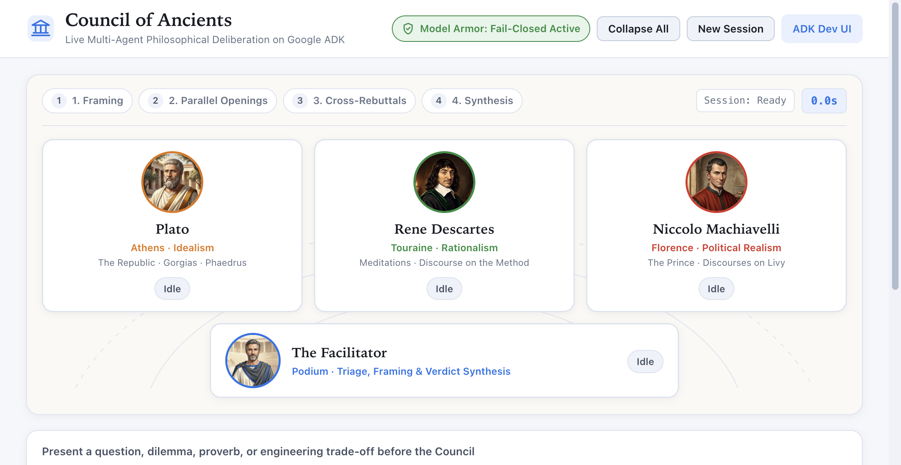
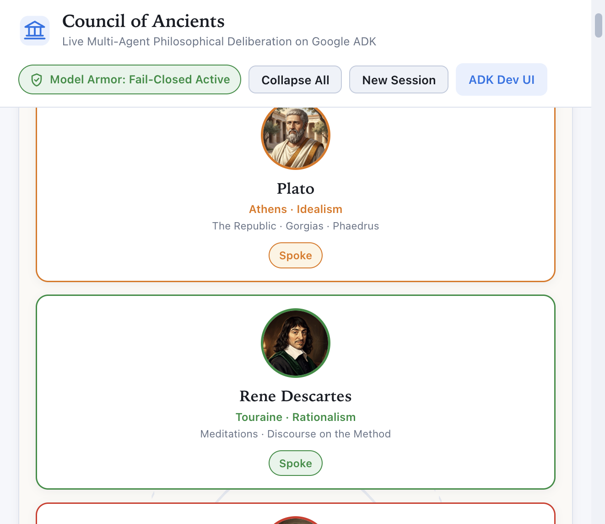
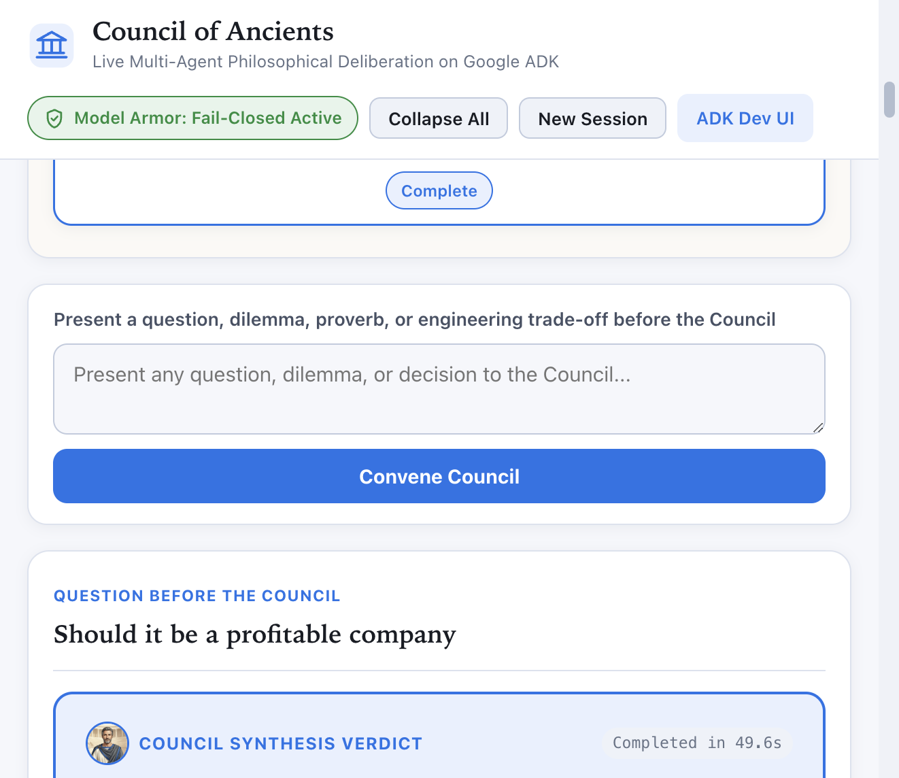

# A C-Suite Conversation on Friday Morning

*Coffee. One simple question. Four seats. No hedge.*

---

Friday morning. The office is still quiet. I’m the Chief Architect of a young startup, and I’ve pulled the CEO, CIO, and CFO into a coffee talk that looks casual—and isn’t.

The question on the napkin:

> **Should it be a profitable company?**

A normal chatbot would smile and say *“it depends.”* That’s a hedge. We don’t need a fence. We need a call.

So we form something a little theatrical—and a little technical:

## Council of C-Suite & Agentic

Not a board meeting with slides. An **agentic** deliberation: each seat argues in parallel, then rebuts the others, then the chair synthesizes a verdict. Same idea as a multi-agent council on Google ADK—only the seats wear executive titles.

| Seat | Lens |
|------|------|
| **CEO** | Purpose — what are we *for*? |
| **CIO** | Method — what’s proven before we incorporate? |
| **CFO** | Independence — can we survive without patrons? |
| **Chief Architect** | Chair — frame, run the protocol, deliver the call |

Fail-closed safety stays on. The chamber UI shows the waves: Framing → Openings → Rebuttals → Synthesis. Seats flip from Idle to Spoke. Then the verdict card lands.

---

### Openings (in under a minute of reading)

**CEO:** Profit is fine as fuel. Fatal as religion. Define the mission first. If surplus becomes the master, we sell applause instead of substance.

**CIO:** Don’t answer until “it” is clear. Profit is an instrument in the material world—not a virtue. Three tests: clear end, judgment that money can’t buy, and whether surplus is actually required to survive.

**CFO:** Good intentions don’t make payroll. Surplus is independence. Dependence on donors is a city with no walls. But unchecked appetite is a quiet tyranny. Design both: earn, and bind the earning with accountability.

---

### The polite fight

**CFO:** Virtue without mechanisms is a wish. Act with imperfect knowledge; fortune won’t wait for a perfect memo.

**CEO:** Survival without a worthy end is efficient emptiness. Better a short life with integrity than a long one that sold the soul.

**CIO:** Skip the poetry and the war stories. Separate means from ends. Keep the will free to refuse a dirty gain.

---

### Verdict (Chief Architect)

**Make profit the servant of purpose, not its master.**

Become a profitable company **if** self-sustaining revenue is required for independence—and **only if** governance keeps profit subordinate to mission: transparent rules, clear accountability, protected autonomy where it matters. Before incorporating: name the end, audit the real costs, lock the non‑negotiables so survival never demands compromise.

**Agreed:** profit is a means; unchecked greed corrodes trust; purpose must be written down first.  
**Still tense:** character vs controls; pause for clarity vs move for survival; perish with integrity vs endure with imperfect virtue.

---

Coffee cups empty. The napkin question got a decision, not a hedge.

That’s the point of **Council of C-Suite & Agentic**: hard questions deserve structured disagreement—then a recommended action you can take into Monday.

---

*Built as an agentic pattern on Google ADK + Vertex AI (Gemini). Product framing: **Council of C-Suite & Agentic**. Screenshots are from a local chamber UI run used as visual reference for the wave stepper, seat states, and synthesis card—rebrand the chrome when you ship your own portal.*
